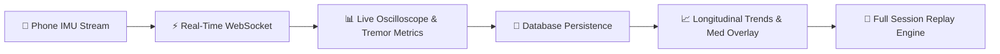

# MotorTrack: Smartphone-Based Motor Symptom Monitoring & Quantitative Assessment System

> **Research Prototype & Medical Telemetry Workstation**  
> *A smartphone-based motor symptom monitoring and quantitative assessment research prototype for movement-signal analysis, with Parkinsonian tremor characteristics as the primary use case. Engineered for real-time mobile browser data capture without requiring native mobile application installations.*

---

## 💡 Clinical Context & Problem Statement

Parkinson's disease symptom evaluations (such as the Movement Disorder Society - Unified Parkinson's Disease Rating Scale, MDS-UPDRS) typically occur during brief clinical appointments scheduled months apart. In-clinic assessments capture only an isolated snapshot of motor status, frequently subject to momentary medication fluctuations and patient anxiety.

**MotorTrack** transforms any commodity smartphone into an investigational biomechanical telemetry instrument. By accessing mobile inertial measurement units (IMUs) through standards-compliant web APIs, patients can execute standardized motor assessment protocols at home. The system quantifies tremor-band oscillations, evaluates temporal associations with user-logged medication events, persists full-resolution raw waveforms, and enables exact chronological session playback for remote clinician review.

> [!IMPORTANT]
> **Defensible Healthcare Scope & Terminology**:  
> MotorTrack is an investigational research prototype. It does **not** provide a medical diagnosis of Parkinson's disease, clinical severity grading, medication response prediction, or treatment recommendations. The system measures and quantifies **tremor-band activity (3.5–7.5 Hz)** and analyzes **temporal correlations** between motor fluctuations and user-logged medication events.

---

## 🎬 The Core Demonstration Flow

The end-to-end user and clinician experience follows a continuous feedback loop:



1. **Patient Pairs Device**: Open dashboard, display QR code, and scan from any smartphone on the local network using a secure, short-lived pairing token. No app store installation required.
2. **Standardized Protocol Execution**: Guided audio prompts and animated visual placement demos direct the patient through **Resting** (hands relaxed in lap), **Postural** (arm outstretched), and **Action** (slow kinetic motion) stages.
3. **Live Oscilloscope & Telemetry**: The Workstation Dashboard plots multi-channel acceleration ($a_x, a_y, a_z$) alongside filtered dynamic magnitude, reporting empirical sampling rate, timestamp jitter, dominant frequency, and RMS amplitude in real time.
4. **Automated Session Summary**: On protocol completion, biomechanical features are compiled and committed to the database with 100% sample integrity.
5. **Longitudinal Timeline & Temporal Association**: Trend charts overlay motor assessment scores against logged medication times, tracking elapsed intervals (e.g., `3h 15m since recorded dose`).
6. **Chronological Session Replay**: Re-inspect any past assessment sample-by-sample with variable playback speeds (1x, 2x) and interactive scrubber.

---

## 🏗️ System Architecture

```
                      +------------------------------------------+
                      |         SMARTPHONE CLIENT (Web)          |
                      |  DeviceMotionEvent Event-Driven Capture  |
                      |  Monotonic Sequence + Performance Clocks |
                      +--------------------+---------------------+
                                           |
                      WebSocket (JSON | Sensor stream: ~50 Hz observed | Visualization: up to 60 FPS)
                                           |
                      +--------------------v---------------------+
                      |           FASTAPI INGESTION              |
                      |  Single Active Stream Isolation & Pairing|
                      |  Empirical Jitter & Packet Loss Monitor  |
                      |  State Machine / Protocol Orchestrator   |
                      +--------------------+---------------------+
                                           |
                      +--------------------v---------------------+
                      |       SIGNAL PROCESSING PIPELINE         |
                      |  1. Per-Axis Highpass Filter (fc=0.5 Hz) |
                      |  2. 4th-Order Bandpass (3.5 - 7.5 Hz)    |
                      |  3. Summed 3D PSD (Rotation Invariant)   |
                      |  4. Parabolic Peak FFT / Resultant RMS   |
                      +---------+--------------------+-----------+
                                |                    |
          +---------------------v-----+         +-----v---------------------+
          |    SQLITE PERSISTENCE     |         |   WORKSTATION DASHBOARD   |
          |  WAL Mode & FK Enforcement|         | 50Hz Oscilloscope (60fps) |
          |  Immutable Session Saves  |         |  Real PSD Spectrum & STFT |
          |  Authoritative Med Events |         |  Replay Player & Trends   |
          +---------------------------+         +---------------------------+
```

---

## 🔬 Signal Processing & Movement Analysis

This is where much of MotorTrack's actual engineering work happens.

Rather than simply plotting incoming sensor values, the backend processes movement signals to extract useful frequency- and time-domain measurements.

### 1. Signal Filtering

The processing pipeline uses Butterworth filters to isolate movement components.

- High-pass filtering with a 0.5 Hz cutoff to reduce gravity-related components.
- A 3.5–7.5 Hz bandpass filter to examine the configured tremor-frequency range.
- Independent processing of the X, Y and Z acceleration axes.

### 2. Frequency-Domain Analysis

MotorTrack uses Fast Fourier Transform (FFT) and Welch's Power Spectral Density (PSD) estimation to examine the frequency distribution of movement signals.

Parabolic peak interpolation is also used to improve dominant-frequency estimates beyond the resolution of individual FFT bins.

### 3. Movement Features

The system calculates measurements including:

- Root Mean Square (RMS) amplitude.
- Dominant tremor frequency.
- Frequency-band power.
- Three-axis signal features.
- Sampling consistency and timestamp jitter.

The three-axis PSD approach is designed to provide rotation-robust tremor measurements, avoiding frequency-doubling artefacts observed when analysing only the magnitude of raw acceleration.

### 4. Additional Motor Assessment Modules

Beyond tremor analysis, the project includes experimental modules for:

| Module | Analysis |
|---|---|
| Gait analysis | Step cadence and movement regularity |
| Freezing of Gait (FOG) | Frequency-band power ratios and episode tracking |
| Finger tapping | Tap intervals, variability and changes in tapping speed |
| Movement characterization | Signal features and movement-pattern analysis |

These modules allow the same sensor-processing framework to be explored across different types of motor assessments.

---

## 🧪 Testing & Benchmarking

MotorTrack includes an automated verification suite covering signal processing, API behaviour, database operations, WebSocket communication and protocol transitions.

The repository currently documents 44 automated tests across 11 test modules, alongside a separate numerical benchmark runner.

Some of the benchmark results using controlled synthetic signals:

| Benchmark | Result |
|---|---|
| Gravity suppression | 60.3 dB attenuation |
| Dominant-frequency estimation | Maximum error of 0.010 Hz across tested tones |
| RMS linearity | Maximum deviation of 0.02% from theoretical values |
| 3D rotation invariance | Consistent 5 Hz dominant frequency across tested orientations |
| Multi-rate sampling | Consistent frequency estimation at 40, 50 and 60 Hz |
| Packet-loss calculation | Exact 20% loss detected in the test case |

The project also includes database integrity checks, foreign-key validation and multi-window FOG episode tracking.

See `benchmark_results.json` and `scripts/run_benchmarks.py` for the recorded results.

**An important distinction:** These results demonstrate numerical behaviour under controlled test conditions. Physical smartphone validation and evaluation using real-world movement recordings remain important next steps.

---

## 🛠️ Technology Stack

| Layer | Technologies |
|---|---|
| Frontend | HTML, CSS, JavaScript |
| Backend | Python, FastAPI |
| Real-time communication | WebSockets |
| Signal processing | NumPy, SciPy |
| Machine learning | Scikit-learn |
| Database | SQLite, SQLAlchemy |
| Visualisation | Plotly |
| Testing | Python unittest |

---
---

## 🚀 Quickstart Guide

### Prerequisites
- Python 3.12 (configured in `.venv`)
- Modern web browser (Chrome, Safari, Edge, Firefox)

### 1. Run Quantitative Signal Benchmarks
```powershell
$env:PYTHONPATH="."
.\.venv\Scripts\python.exe scripts/run_benchmarks.py
```

### 2. Run the Full 44-Test Verification Suite
```powershell
$env:PYTHONPATH="."
.\.venv\Scripts\python.exe -m unittest discover tests -v
```

### 3. Run Database Migration & Integrity Verification
```powershell
$env:PYTHONPATH="."
.\.venv\Scripts\python.exe backend/app/migrate_db.py
```

### 4. Launch the MotorTrack Application Server
```powershell
.\.venv\Scripts\python.exe run.py
```
Open a browser and navigate to `http://localhost:8000`.

### 5. Pair a Phone or Run Built-in Simulation
- **Smartphone**: Click **"Connect Phone"** on the dashboard header, scan the QR code, tap **"Activate Sensors"**, and hold the device.
- **Simulator**: Click **"Simulator: OFF"** on the header, select a profile (e.g. *Synthetic 5.2 Hz Tremor Signal*), and click **"Start Simulation"**.

---

## ⚖️ Ethical & Research Scope Notice
MotorTrack is developed strictly for movement-signal analysis, biomedical engineering research, and quantitative telemetry. Sensor captures and synthetic profiles are intended for algorithmic benchmarking and longitudinal observation. It does not provide medical diagnosis, therapeutic recommendations, or MDS-UPDRS clinical severity certification.
